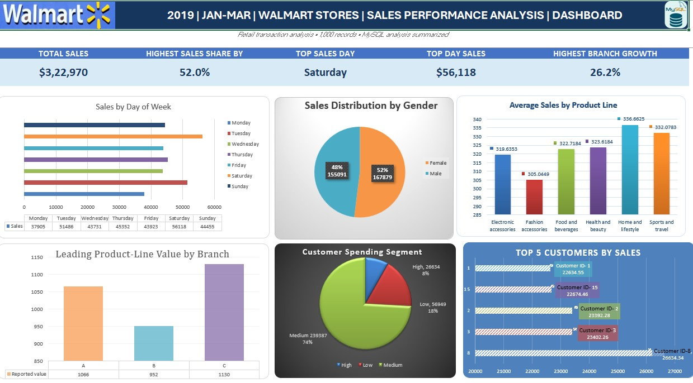

# Walmart Sales Performance Analysis Using Advanced MySQL



## Introduction

Walmart, a major retail chain, operates across several cities, offering a wide range of products. The dataset provided contains detailed transaction data, including customer demographics, product lines, sales figures, and payment methods. This project will use advanced SQL techniques to uncover actionable insights into sales performance, customer behavior, and operational efficiencies

## 1. Project Overview

In this project, I performed a **Sales Performance Analysis of Walmart Stores using Advanced MySQL Techniques** to explore historical sales transactions, identify business trends, and answer important business questions.

The project focuses on analyzing sales performance across different branches, understanding customer spending patterns, evaluating product profitability, identifying unusual transactions, and discovering purchasing trends.

Using MySQL, I transformed transactional data into meaningful business insights and presented the findings through Excel charts and a PowerPoint presentation.

---

## 2. Business Problem

Walmart operates across multiple cities and offers different product categories to customers with varying purchasing preferences.

**Business Objective:** Analyze historical Walmart sales transactions using advanced SQL queries to identify actionable insights that can support better business decisions, improve sales strategies, and enhance customer engagement.

The business needs to understand:

- Which branch demonstrates the strongest sales growth?
- Which product lines contribute the most profit to each branch?
- Who are the high-value customers?
- Are there unusual or potentially suspicious sales transactions?
- Which payment methods are preferred in different cities?
- How do purchasing patterns differ between male and female customers?
- Which products are preferred by members and normal customers?
- Which customers make repeat purchases?
- Who are the top revenue-generating customers?
- Which days of the week generate the highest sales?


---

## 3. Project Objectives

The primary objectives of this project are:

1. Analyze branch-wise sales performance and monthly growth.
2. Identify the most profitable product line for each branch.
3. Segment customers based on their purchasing behavior.
4. Detect unusual sales transactions using statistical techniques.
5. Identify popular payment methods across different cities.
6. Analyze monthly sales distribution by gender.
7. Understand product preferences across customer types.
8. Identify customers making repeat purchases within 30 days.
9. Find the top five customers based on sales revenue.
10. Analyze sales trends across different days of the week.

---

## 4. Tools and Technologies

| Tool | Purpose |
| :--- | :--- |
| **MySQL** | Database creation, data management, SQL querying, and analysis |
| **MySQL Workbench** | Database administration and executing SQL queries |
| **Microsoft Excel** | Data visualization, charts, and graphical representation |
| **Microsoft PowerPoint** | Presenting analytical findings and business insights |

### SQL Techniques Used

- Database and table creation
- Data importing and exploration
- `SELECT`, `WHERE`, `GROUP BY`, `ORDER BY` , `LIMIT`
- Aggregate functions: `SUM()`, `AVG()`, `COUNT()`
- `JOIN` operations
- Subqueries and Common Table Expressions (CTEs), where applicable
- Window functions, where applicable `LAG`
- `CASE` statements
- Date and time functions `DATE`
- Statistical calculations
- Customer segmentation
- Sales growth calculations
- Anomaly detection


---

## 5. Dataset Description
The project uses the Walmart sales transaction dataset containing **1,000 records**.

The dataset includes transaction-level information related to:

- Invoice ID
- Branch
- City
- Customer type
- Gender
- Product line
- Unit price
- Quantity
- Tax
- Total sales
- Date and time
- Payment method
- Cost of goods sold
- Gross income
- Rating

Each `Invoice ID` represents a unique transaction identifier. The dataset provides information about customer demographics, product categories, transaction values, and payment preferences.

**Dataset source:** [Walmartsales_Dataset](https://github.com/SatishKumar-ds93/Advanced-SQL-Sales-Performance-Analysis-Walmart/blob/main/Walmartsales%20Dataset%20-%20walmartsales.csv)

---

## 6. Database Preparation and Data Import

The first step was to create a MySQL database and import the Walmart sales CSV file.

### Step 1: Create Database
```sql
CREATE DATABASE walmart_dataset;
```


### Step 2: Select Database
```sql
USE walmart_dataset;
```

### Step 3: Create Table

I created a table named `wsales` to store the Walmart sales transaction records.


### Step 4: Import CSV File

Imported the Walmart sales dataset into MySQL Workbench.


### Step 5: Verify Imported Records
```sql
SELECT *
FROM walmart_dataset.wsales;
```
The database successfully imported **1,000 transaction records**.

---


## 7. TASK: 

Solution of Task 1 to 10

### Task 1: Identifying the Top Branch by Sales Growth Rate

- **Business Question:** Which Walmart branch experienced the highest sales growth over the observed months?
- **Analysis:** Calculated total sales for each branch across January, February, and March, then compared monthly sales growth rates.

- **Query 1:** Calculate total sales by branch and month

   - **SQL Explanation**: Calculate the total monthly sales by each branch
   
   - `SELECT Branch`: select the column of Branch from the table
   - `DATE_FORMAT(Date, '%Y-%m')`: Converts the date into a year-month format, such as 2019-01.
   - `SUM(Total)`: Adds all transaction amounts for that branch and month.
   - `GROUP BY Branch, Month`: Creates one sales total for each branch-month combination.
   - `ORDER BY Branch, Month`: Displays the results in branch and month order.
 
   - **Mathematical Formula**: Monthly Sales by each Branch in the month = Total sums of total sales of each branch in a month

   - **Results**: Total Monthly Sales by each Branch

      

- **Query 2:** After calculating monthly sales, we need to compare the current month's sales with the previous month's sales for the same branch. 

  - **SQL Explanation**: Calculate monthly growth rate using `LAG()` **Window Function**
 
  - `WITH MonthlySales AS`	Creates a CTE (Common Table Expression) to store monthly sales results temporarily
  - `LAG(Total_Sales`)	Retrieves the previous month's sales
  - `OVER()`	Defines the window over which the function operates
  - `PARTITION BY Branch`	Separates calculations for each branch
  - `ORDER BY Month`	Ensures months are compared chronologically
 
  - **Mathematical Formula**: Growth Rate = (Current Month Sales - Prev. Month Sales)/ Prev. Month Sales

                              Growth Rate(%) = (Current Price - Prev. Price)/Prev. Price x 100
    
  - **Noted**: Why `PARTITION BY Branch` matters: Without it, the previous value could belong to a different branch. Partitioning ensures Branch A is compared    only with its own previous month, and the same applies to other branches.

  - **Results**: Average monthly growth sales

     


- **Query 3:** Find the branch with the highest average growth sales rate

  - **SQL Explanation**: Calculating monthly growth gives us multiple growth rates for each branch. To identify the overall top-performing branch.

  - `AVG(Growth_Rate)`: Calculates the average monthly growth rate.
  - `GROUP BY Branch`: Calculates one average for each branch.
  - `ORDER BY Avg_Growth_Rate DESC`: Places the highest average first.
  - `LIMIT 1`: Returns the top branch.

  - **Mathematical Formula**: Sum of Average Monthly Growth Rates/Number of valid monthly growth rates

  - **Noted**: The first month for each branch has no previous month, so LAG() returns NULL. AVG() ignores NULL values


  - **Results**: Highest Growth Rate

    

- **Key Findings:**
  - Branch A recorded the highest reported monthly growth rate.
  - Its March 2019 growth rate was approximately **26.15%**.
- **Business Recommendation:** Investigate the factors behind Branch A's growth and evaluate whether its successful sales strategies can be replicated across other branches.


### Task 2: Finding the Most Profitable Product Line for Each Branch

- **Business Question:** Which product line contributes the highest profit to each branch?
- **Analysis:** Compared gross income and cost of goods sold to evaluate product-level profitability across the branches.

- **Query 1**: Calculate total gross income by branch and product line

  - **SQL Explanation**: Calcultion of profit(gross_income) = difference between total(cogs+tax5%) and revenue or cogs = (unit price x quantity)
 
  - `SUM(gross_income)`: Adds gross income from all transactions.
  - `GROUP BY Branch, Product_line`: Groups records by branch and product category.
  - `ORDER BY Branch, Total_Profit DESC`: Sorts product lines from highest to lowest gross income within each branch.
 
  - **Mathematical Formula**: Total Gross Income = Sum of gross income per transactions

- **Query 2**: Find the highest-profit product line in each branch

  - **SQL Explanation**:The first query calculates gross income for every product line. However, Walmart wants only the product line with the highest gross income in each branch.

    This query uses a CTE and a subquery to identify the maximum value for every branch.

  - `ProfitData`: Stores total gross income by branch and product line.
  - `MAX(Total_Profit)`: Finds the maximum gross income within each branch.
  - `GROUP BY Branch`: Calculates a separate maximum for each branch.
  - `(Branch, Total_Profit)` `IN (...)`: Matches the branch and maximum gross income against the CTE.
  - The outer query returns the corresponding product line.

   - **Mathematical Formula**: {Best Product Line}={MAX}({Total Gross Income})
 
   - **Results**

     

- **Key Findings:**

| Branch | Top Product Line | Reported Value |
| :--- | :--- | :--- |
| **A** | Home and Lifestyle | 1,066 |
| **B** | Health and Beauty | 952 |
| **C** | Food and Beverages | 1,130 |

- **Business Recommendation:** Evaluate product-level costs, pricing, and gross income to identify opportunities for improving profitability.

### Task 3: Analyzing Customer Segmentation Based on Spending

- **Business Question:** How can customers be classified according to their total purchasing amounts?
- **Analysis:** Aggregated customer purchase amounts and classified customers into three spending categories:
  - High Spenders
  - Medium Spenders
  - Low Spenders

- **Query 1**: Calculate total spending per customer and average spending per customer

  - **SQL Explanation**: Sum of spending per customer
 
  - `SUM(Total)` measures the customer's cumulative spending.

  - **Results**: Total Spending by Customer

  

  - `AVG(Total)` measures the average transaction amount.

  - **Results**: Average Spending by Customer = Total customer spending/Number of transactions

  

- **Query 3**: After observation of total spending by each customer I Classify customers into 3 spending tiers- Low, Medium, High

  - **SQL Explanation** Once the total spending of each customer is calculated, Walmart can classify customers into different spending groups.

  - `ROUND(SUM(Total), 2)`: Calculates total spending and rounds it to two decimal places.
  - `CASE`: Applies conditional logic to classify customers.
  - `WHEN`: Defines each condition.
  - `THEN`: Assigns the corresponding category.
  - `ELSE`: Assigns the category when previous conditions are not satisfied.

  - **Results** - Tier wise Customer Segmentation

    

- **Key Finding:** The analysis identified different spending levels, with the highest reported individual customer spending of approximately **$26,634**.
- **Business Recommendation:** Develop targeted loyalty programs, personalized offers, and retention campaigns for high-value customers.

### Task 4: Detecting Anomalies in Sales Transactions

- **Business Question:** Are there transactions with unusually high or low sales compared with their product-line averages?
- **Analysis:** Compared individual transaction amounts against product-line averages and standard deviations to identify unusual observations.

- **Query**: To find the anomalies

   - **SQL Explanation**: These are the steps to detecting anomalies in sales transactions

   - `AVG()` to calculate average sales by product line.
   - `CTE` to store average sales.
   - `JOIN` to connect individual transactions with product line averages.
   - Mathematical `deviation formula` to measure differences.
   - `ABS()` to detect high and low deviations.
   - `WHERE` to filter transactions exceeding the threshold.
   - `ORDER` BY to sort the anomalies.

   **Step1**: Calculate average sales by product line-

   - Average Sales= Sum of transactions sales(Total)/Number of Transactions

   **Step2**: `Join` transaction data with average sales

   - Why `JOIN` is used
  
    The original wsales table contains individual transaction values, while the AvgSales CTE contains average sales by product line.

    The join connects each transaction with its product line's average.
    - `ws` is an alias for the original table.
    - `avg` is an alias for the CTE.
    - `ON` matches the product line in both datasets.

   **Step3**: Calculate deviation
 
    - (`ws.Total` - `avg.Avg_Sales`) / `avg.Avg_Sales` `AS` Deviation
    - It measures how far a transaction is from its product line's average, relative to that average.

    **Mathematical formula**

    - Deviation=(Transaction Sales-Average Sales)/Average Sales

   **Step4**: Identify anomalies using `ABS()`

    - Why ABS() is used because ABS() returns the absolute value, removing the negative sign.
    - This means the query can identify both:
    - Transactions more than 50% above average.
    - Transactions more than 50% below average.

    - **Logical formula** {Deviation}>0.5

    - Example:

| Deviation |	Absolute deviation | Anomaly |
| :-------- | :----------------- | :------ |
|    0.20   |	       0.20        |	  No   |
|    0.60   |	       0.60        |	  Yes  |
|   -0.70   |	       0.70        |	  Yes  |
|   -0.30   |	       0.30        |	  No   |

  
  **Step5 Results**: Sort the results

  


- **Key Finding:** One highlighted transaction was identified as an anomaly:
  - **Invoice ID:** `283-26-5248`
  - **Product Line:** Food and Beverages
  - **Sales Amount:** $1,034.46
  - **Product-Line Average:** $323.64
  - **Standard Deviation:** $236.76
- **Business Recommendation:** Review unusually large transactions to determine whether they represent bulk purchases, exceptional customer behavior, or possible data-quality issues.

### Task 5: Most Popular Payment Method by City

- **Business Question:** Which payment methods are most frequently used by customers in different cities?
- **Analysis:** Grouped transactions by city and payment method and compared transaction frequencies.

- **Query**: To find the payment method is most frequently used by customers in each city

  - **SQL Explanation**: These are the steps

  - `COUNT(*)` to count payment transactions.
  - `GROUP BY City`, Payment to aggregate payment methods.
  - `CTE` to store ranked payment results.
  - `ROW_NUMBER()` to rank payment methods.
  - `PARTITION BY City` to rank independently within each city.
  - `WHERE rn = 1` to return the most popular method.

   **Step1**: `Count` payment transactions

   - Payment Count= Number of Transactions for a Payment Method

   **Step2**: `Rank` payment methods using ROW_NUMBER()

   - Why ROW_NUMBER() is used
   - It assigns a sequential ranking to each payment method within each city

   **Step3**: Ranked it

   - `PARTITION BY City`: Restarts the ranking for each city.
   - `ORDER BY COUNT(*) DESC`: Ranks the most frequently used payment method first.
   - `ROW_NUMBER()`: Assigns ranking numbers such as 1, 2, 3.
  

 **Results**:

  

- **Key Findings:**

| City | Most Popular Payment Method | Transactions |
| :--- | :--- | :--- |
| **Mandalay** | E-wallet | 113 |
| **Naypyitaw** | Cash | 124 |
| **Yangon** | E-wallet | 126 |

- **Business Recommendation:** Optimize payment-related promotions and customer convenience according to regional payment preferences.


### Task 6: Monthly Sales Distribution by Gender

- **Business Question:** How does monthly sales revenue differ between male and female customers?
- **Analysis:** Grouped total sales by month and gender to understand differences in purchasing patterns.

- **Query**:

  - **SQL Explanation**

  - `DATE_FORMAT()` to extract the month.
  - `SUM()` to calculate monthly sales.
  - `GROUP BY Month, Gender` to aggregate sales.
  - `ORDER BY` to sort the results.
  - `LIMIT` to restrict the number of returned records.
  - `ROW_NUMBER()` and `PARTITION BY` in the improved version to rank gender sales within each month.

  - Monthly sales by Gender

    

  - Highest monthly sales by Gender

    

- **Key Findings:**
  - **January:** Female sales were **$59,140**, compared with male sales of **$57,154**.
  - **February:** Female sales were **$56,328**, compared with male sales of **$40,885**.
  - **March:** Male sales were **$57,052**, compared with female sales of **$52,411**.
  - Overall, female customers contributed approximately **52%** of reported sales.
- **Business Recommendation:** Use gender-based purchasing trends as one input when developing customer-focused marketing campaigns, without relying on gender alone for customer targeting.

### Task 7: Best Product Line by Customer Type

- **Business Question:** Which product lines are preferred by Member and Normal customers?
- **Analysis:** Compared sales across product lines for the two customer categories.

- **Query**:

- **SQL Explanation**

  - `SUM()` to calculate total sales.
  - `GROUP BY Customer_type, Product_line` to aggregate product sales.
  - `CTE` to store the aggregated and ranked data.
  - `ROW_NUMBER()` to rank product lines.
  - `PARTITION BY Customer_type` to rank separately by customer type.
  - `WHERE rn = 1` to identify the highest-selling product line.

  - Best Product Line By Customer Type

    

  - Best Product Line Member vs Normal

    

- **Key Findings:**

| Customer Type | Top Product Line | Reported Sales |
| :--- | :--- | :--- |
| **Member** | Food and Beverages | $31,357.62 |
| **Normal** | Electronic Accessories | $29,839.04 |

- **Business Recommendation:** Develop targeted product promotions and member-exclusive offers based on observed purchasing preferences.

### Task 8: Identifying Repeat Customers

- **Business Question:** Which customers made multiple purchases within a 30-day period?
- **Analysis:** Examined customer transaction dates and identified repeat purchases within the specified timeframe.

- **Query 1**: Identify customers who purchased again within 30 days

  - **SQL Explanation**:

    - `LAG()` to retrieve previous purchase dates.
    - `PARTITION BY Customer_ID` to compare purchases for the same customer.
    - `ORDER BY Date` to arrange purchases chronologically.
    - `DATEDIFF()` to calculate days between purchases.
    - `IS NOT NULL` to exclude the first purchase.
    - `DISTINCT` to return unique repeat customers.
    - `COUNT(*)` to count qualifying repeat-purchase transactions.
    - Subquery to perform date comparison before filtering.

 - **Step 1**: Find the previous purchase date using `LAG()`

   - Why `LAG()` is used
   - `LAG()` retrieves the previous row's date within the same customer's transaction history.

   - Why `PARTITION BY Customer_ID` is used
   - It ensures that the previous purchase date belongs to the same customer.
   - Without partitioning, a transaction from another customer could incorrectly become the previous purchase.

   - Why `ORDER BY Date` is used
   - It ensures the transactions are arranged chronologically
  
- **Step 2**: Calculate the difference between purchase dates

   - Why `DATEDIFF()` is used
   - It calculates the number of days between two dates.

- **Mathematical formula** Days Between Purchases = (Current Purchase Date) - (Previous Purchase Date)


- **Step 3**: Apply the 30-day condition

   - Why these conditions are used
   - `DATEDIFF(...) <= 30`: Keeps purchases made within 30 days of the previous purchase.
   - prev_purchase_date `IS NOT NULL`: Removes the first purchase for each customer because there is no earlier purchase to compare.

- **Step 4**: Use `DISTINCT`

  - Why DISTINCT is used
  - A customer might make multiple repeat purchases within 30 days. DISTINCT ensures that the customer ID appears only once in the output.


**Query 2**: Count qualifying repeat purchases for each customer

  - **Results**

    

- **Key Findings:**
  - **Customer group 1–10:** 66 reported repeat purchases.
  - **Customer group 11–15:** 65 reported repeat purchases.
- **Business Recommendation:** Identify customers with consistent purchasing behavior and introduce loyalty incentives to encourage continued engagement.

### Task 9: Finding Top 5 Customers by Sales Volume

- **Business Question:** Who are the five highest revenue-generating customers?
- **Analysis:** Aggregated total sales revenue by customer and ranked customers based on their contribution.

- **Query**:

  - **SQL Explanation**:

  - `SUM()` to calculate total customer sales.
  - `GROUP BY Customer_ID` to aggregate sales by customer.
  - `ORDER BY Total_Sales DESC` to rank customers by revenue.
  - `LIMIT 5` to return the top five customers.

  - **Results**

    

- **Key Findings:**

| Customer ID | Total Sales |
| :--- | :--- |
| **8** | $26,634.34 |
| **3** | $23,402.26 |
| **2** | $23,392.28 |
| **15** | $22,674.46 |
| **1** | $22,634.55 |

- **Business Recommendation:** Recognize high-value customers through loyalty rewards, personalized promotions, and retention initiatives.

### Task 10: Analyzing Sales Trends by Day of the Week

- **Business Question:** Which days of the week generate the highest sales revenue?
- **Analysis:** Extracted the day of the week from transaction dates and calculated total sales for each day.

- **Query 1**: Calculate total sales for each weekday

- **SQL Explanation**:

  - DAYNAME() to extract the weekday.
  - SUM() to calculate sales per weekday.
  - GROUP BY to aggregate sales.
  - FIELD() to arrange weekdays in calendar order.
  - ORDER BY Total_Sales DESC to rank weekdays by sales.
  - LIMIT 1 to return the highest-sales weekday.

**Step 1**: Extract the weekday name

  - Why DAYNAME() is used
  - It extracts the weekday name from a date

**Step 2**: Calculate total sales

  - **Mathematical Formula** {Sales by Weekday} = {Transaction Sales for That Weekday}

**Step 3**: Group transactions by weekday

 - This combines transactions from the same weekday.

 - For example, all Monday transactions are grouped together, regardless of the month or date.


**Step 4**: Sort weekdays using FIELD()
 
 - Why FIELD() is used

 - By default, alphabetical sorting would place Friday before Monday, which is not the normal weekday sequence.

 - FIELD() allows you to define your preferred order.


- It returns the position of a value in the supplied list:

|    Day    |	FIELD position |
| Sunday    |	      1        |       
| Monday    |       2        | 
| Tuesday   |       3        |        
| Wednesday |       4        |
| Thursday	|       5        |   
| Friday	  |       6        |
| Saturday	|       7        |  
  
  - Days of Week


- **Query 2**: Find the weekday with the highest sales

**Formula** {Highest Sales Day} = {MAX}({Sales by Weekday})
  
  - Highest Sales Day


- **Key Findings:**

| Day | Reported Total Sales |
| :--- | :--- |
| **Saturday** | $56,120.81 |
| **Tuesday** | $51,482.25 |
| **Thursday** | $45,349.25 |
| **Sunday** | $44,457.89 |
| **Friday** | $43,926.34 |
| **Wednesday** | $43,731.14 |
| **Monday** | $37,899.08 |

- **Business Recommendation:** Consider increasing promotional activities, inventory availability, and operational readiness on high-sales days, particularly Saturdays.

---

## 8. Overall Business Insights

The analysis provides several useful observations:

1. **Branch Performance:** Branch A demonstrated a strong reported monthly sales growth rate.
2. **Product Profitability:** Different branches have different leading product lines, highlighting the importance of branch-level product strategies.
3. **Customer Segmentation:** Customer spending patterns provide opportunities for targeted marketing and loyalty programs.
4. **Anomaly Detection:** Unusual transaction values can help identify records requiring further investigation.
5. **Payment Preferences:** Payment behavior differs across cities.
6. **Customer Behavior:** Gender and customer-type analysis provides additional perspectives on purchasing patterns.
7. **Customer Retention:** Repeat purchases and high-value customers offer opportunities to strengthen customer relationships.
8. **Weekly Sales Trends:** Saturday recorded the highest reported sales, while Monday recorded the lowest.

---

## 9. Business Recommendations

Based on the analysis, the following actions could help improve retail performance:

- Replicate successful branch-level sales strategies where appropriate.
- Review product profitability and optimize product-level pricing and costs.
- Introduce customer segmentation-based loyalty programs.
- Investigate unusual sales transactions and improve data-quality monitoring.
- Customize payment promotions according to city-level preferences.
- Develop targeted product campaigns based on customer purchasing behavior.
- Encourage repeat purchases through customer retention initiatives.
- Plan staffing, promotions, and inventory according to weekly sales trends.

---

## 10. Project Conclusion

This project demonstrates how SQL can be used to convert raw retail transaction data into meaningful business insights.

By analyzing 1,000 Walmart sales transactions, I explored branch performance, product profitability, customer segmentation, transaction anomalies, payment preferences, repeat purchases, top customers, and weekly sales trends.

The project strengthened my practical understanding of MySQL database management, advanced SQL querying, analytical thinking, and business problem-solving.

It also demonstrated the importance of connecting technical SQL analysis with business objectives and communicating findings through visual presentations.


## Additional Task: Interactive Sales Dashboard Creation Using Microsoft Excel

### 1. Overview

[Walmart Dashboard](https://github.com/SatishKumar-ds93/Advanced-SQL-Sales-Performance-Analysis-Walmart/blob/main/Images/Walmart_Sales_Performance_Dashboard.jpg)

After completing the Walmart Sales Performance Analysis using advanced MySQL queries, I extended the project by creating an additional sales performance dashboard using **Microsoft Excel**.

This dashboard was not part of the original project requirements. I independently performed this additional task to transform the SQL analysis results into a more visual and interactive reporting solution.

The objective was to convert the analytical results exported from MySQL into structured Excel data, prepare the data using **Power Query**, summarize key business metrics using **PivotTables**, and present the findings through charts and a consolidated dashboard.

---

### 2. Tools and Technologies

[Walmart Dashboard Excel](https://github.com/SatishKumar-ds93/Advanced-SQL-Sales-Performance-Analysis-Walmart/blob/main/Walmart_Sales_Performance_Dashboard.xlsx)

- **MySQL:** Extracted and analyzed Walmart sales data using SQL queries.
- **Microsoft Excel:** Imported and organized the SQL query results.
- **Power Query Editor:** Prepared, cleaned, and transformed the exported data.
- **PivotTables:** Summarized sales performance across different business dimensions.
- **PivotCharts / Excel Charts:** Visualized important business metrics and trends.
- **Excel Dashboard:** Consolidated the analysis into a visual reporting interface.


---

### 3. Dashboard Development Workflow

The dashboard was developed through the following steps:

#### Step 1: Export SQL Analysis Results

After completing the MySQL analysis tasks, I exported the corresponding query results into Excel for further analysis and visualization.

#### Step 2: Data Preparation Using Power Query

- Imported the exported SQL result files into Excel.
- Checked column names, data types, and data consistency.
- Applied the required data transformation and cleaning steps.
- Prepared structured datasets for PivotTable analysis.

#### Step 3: Create PivotTables

Created PivotTables to summarize the SQL analysis results and organize the data into meaningful business categories, including sales trends, customer segments, gender-wise sales, product-line performance, and customer rankings.

#### Step 4: Create PivotCharts and Visualizations

Used Excel charts to represent the summarized results and make the findings easier to understand.

#### Step 5: Design the Dashboard

Combined the key visualizations into a consolidated dashboard using a Walmart-inspired **blue and yellow** colour theme.

---

### 4. Dashboard Components and Business Metrics

The dashboard presents the following key analysis areas:

| Dashboard Component | Business Purpose |
| :--- | :--- |
| **Sales by Day of Week** | Identify the highest and lowest sales days. |
| **Sales Distribution by Gender** | Compare male and female customer sales. |
| **Branch-wise Product-Line Contribution** | Compare the leading product-line values reported for each branch. |
| **Customer Spending Segments** | Understand the distribution of high, medium, and low spending segments. |
| **Top 5 Customers by Sales** | Identify the highest revenue-generating customers. |
| **Average Sales by Product Line** | Compare average sales performance across product categories. |

---

### 5. Key Benefits of the Additional Dashboard

- Converted SQL query outputs into visual business reports.
- Improved the presentation and interpretation of analytical findings.
- Demonstrated the use of Power Query for data preparation.
- Applied PivotTables to summarize business data.
- Used charts to communicate sales trends and customer behaviour.
- Extended the original SQL project into a practical reporting and business intelligence workflow.

---

### 6. Project Extension: From SQL Analysis to Excel Reporting

This additional task demonstrates how SQL analysis can be extended into an Excel-based reporting workflow:

`MySQL` ➔ `Excel Export` ➔ `Power Query` ➔ `PivotTables` ➔ `PivotCharts` ➔ `Sales Dashboard`

The combined project demonstrates practical skills in data extraction, data preparation, aggregation, visualization, and business reporting.

---

### 7. Deliverable

- **Excel Dashboard:** `Walmart_Sales_Performance_Dashboard.xlsx`
- **Dashboard Sheets:** `Dashboard`, `Chart_Data`, and `Read_Me`
- **Project Analysis:** MySQL query solutions and PowerPoint presentation

> **Note:** The Excel dashboard is an additional deliverable created beyond the original MySQL project requirements.

------------------------------------ END --------------------------------------------------------
